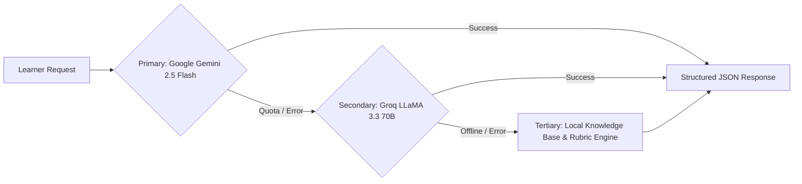

# A1 ReadyCheck (v3.0.0) — 5-Skill AI-Assisted German A1 Exam Readiness Platform

[](https://vitejs.dev/)
[](https://react.dev/)
[](https://tailwindcss.com/)
[](https://developer.mozilla.org/en-US/docs/Web/API/Web_Speech_API)
[](https://ai.google.dev/)
[](https://groq.com/)
[](https://vercel.com/)

A1 ReadyCheck is an AI-assisted diagnostic platform helping German language learners evaluate their true examination readiness across **all 5 official CEFR A1 skills** before booking expensive **Goethe-Zertifikat A1 (Start Deutsch 1)** or **ÖSD Zertifikat A1** exams (€100–€160).

---

## 🎯 5-Skill Assessment Architecture (12 Tasks)

| Skill Module | Tasks | Scoring Engine | Max Score | CEFR A1 Task Focus |
| :--- | :---: | :---: | :---: | :--- |
| **Wortschatz (Vocabulary)** | 3 | Deterministic | 3.0 | Food & beverages, daily routines, transit & city locations |
| **Grammatik (Grammar)** | 3 | Deterministic | 3.0 | Accusative articles (*einen/den*), stem vowel change (*fahren*), modal verbs (*können*) |
| **Leseverstehen (Reading)** | 2 | Deterministic | 2.0 | Bakery opening hours sign, birthday party invitation email |
| **Hörverstehen (Listening)** | 2 | Deterministic | 2.0 | Train station platform announcement, clinic voicemail message (SpeechSynthesis audio) |
| **Sprechen (Speaking)** | 2 | AI Rubric (0–3) | 2.0 | Self-introduction (*Teil 1*), café order (*Teil 2*) with microphone capture |
| **Total** | **12** | **Hybrid** | **12.0** | **Comprehensive CEFR A1 diagnostic coverage** |

---

## ⚡ Multi-Provider AI Architecture & Failover

The platform features an automated serverless failover pipeline for speaking evaluation and Doro AI guidance:



1. **Primary:** Google Gemini 2.5 Flash (`gemini-2.5-flash`).
2. **Secondary:** Groq API (`llama-3.3-70b-versatile`) — automatically triggered if Gemini returns rate limits, token exhaustion, or connection errors.
3. **Tertiary:** Predefined local CEFR A1 rubric engine & curated knowledge base (`knowledge-base/*.json`). Zero crashes even when running completely offline.

---

## 📊 4-Tier Readiness Classification Matrix

- **≥ 85% Score:** *Strong Practice Performance* — **Condition:** Requires ≥ 50% in *every* individual skill. High probability of passing Goethe / ÖSD examination.
- **70% – 84% Score (or ≥ 85% with a sub-50% skill):** *Almost There* — Solid base; focus 10–14 days on the single weakest module before registering.
- **50% – 69% Score:** *Needs Targeted Practice* — Do not book exam date yet; follow Doro’s study plan.
- **< 50% Score:** *Build A1 Foundations* — Fundamental course review recommended.

---

## 💻 Running the Test Suites & Local Dev

```bash
# 1. Install dependencies
npm install

# 2. Run all 5 automated unit test suites
node test/assessment_tests.mjs        # 5-skill scoring engine & boundary condition tests
node test/speaking_rubric_tests.mjs   # 4-dimension speaking rubric tests
node test/recommendations_tests.mjs   # Targeted practice recommendation tests
node test/doro_ai_tests.mjs           # Doro AI guardrail & knowledge base tests
node test/groq_failover_tests.mjs     # Dual-provider Gemini -> Groq failover tests

# 3. Start local development server (includes serverless API middleware)
npm run dev

# 4. Production build
npm run build
```

---

## 🚀 Push to GitHub

```bash
# 1. Initialize remote (replace with your GitHub repository URL)
git remote add origin https://github.com/YOUR_USERNAME/YOUR_REPOSITORY.git

# 2. Rename branch to main if preferred
git branch -M main

# 3. Push to GitHub
git push -u origin main
```

> **Security Note:** `.env` is listed in `.gitignore` and is never committed to GitHub.

---

## 🌐 Deploying to Vercel

1. Log in to [Vercel](https://vercel.com/) and click **"Add New Project"**.
2. Select your GitHub repository.
3. Framework Preset: **Vite** (auto-detected).
4. Root Directory: `./` (leave default).
5. Add your **Environment Variables** in the Vercel dashboard:
   - `GEMINI_API_KEY` = your Google Gemini API key
   - `GROQ_API_KEY` = your Groq API key
6. Click **Deploy**.

Vercel will automatically build the static React SPA and deploy the `/api/doro` and `/api/evaluate-speaking` serverless functions.
