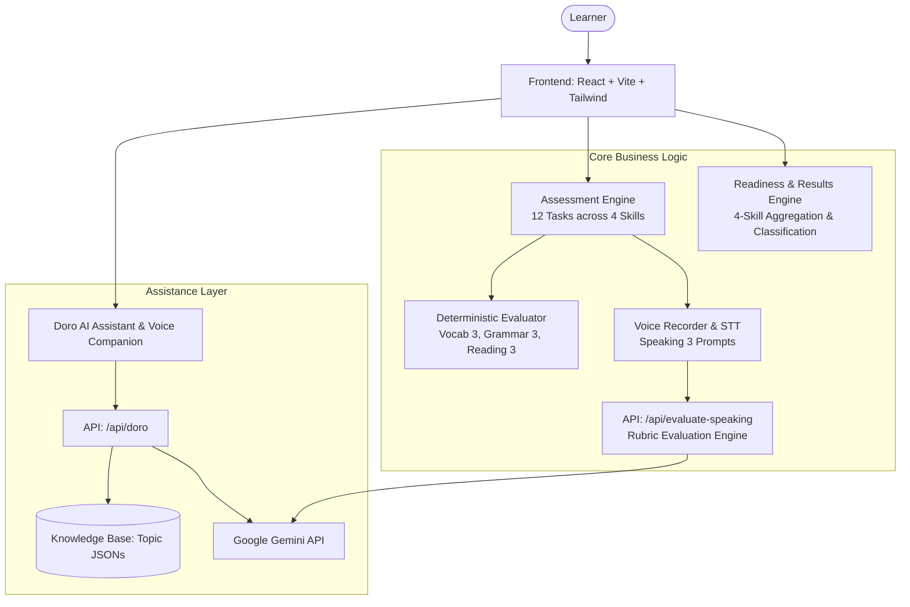

# A1 ReadyCheck — Technical Architecture & System Design (v2.0.0)

## 1. Project Overview

- **Project Name:** A1 ReadyCheck
- **Version:** 2.0.0
- **Type:** AI-Assisted German A1 Exam Readiness Platform
- **Description:** A German A1 diagnostic assessment platform combining vocabulary, grammar, reading and speaking assessments with an AI learning assistant named Doro.
- **Primary Goal:** Help A1 German learners understand their strengths and weaknesses before booking Goethe or ÖSD examinations.
- **Development Constraint:** Four-hour MVP sprint (240 minutes).

---

## 2. Product Architecture & Core Modules

The platform is structured into three decoupled core modules:



### 2.1 Assessment Engine (`assessment_engine`)
* **Responsibility:** Manage the 12-question assessment and evaluate objective questions using deterministic scoring and speaking questions via AI rubric scoring.
* **Skill Allocation (12 Total Tasks):**
  - **Vocabulary (*Wortschatz*):** 3 questions, deterministic scoring, max score: 3.
  - **Grammar (*Grammatik*):** 3 questions, deterministic scoring, max score: 3.
  - **Reading Comprehension (*Leseverstehen*):** 3 questions, deterministic scoring, max score: 3.
  - **Speaking (*Sprechen*):** 3 open-ended voice prompts, AI-assisted rubric scoring, max score: 3.
* **Features:** Question navigation, progress tracking, answer persistence, microphone voice recording, transcription handling, assessment submission, and skill-wise score calculation.
* **Critical Rule:** Objective scores (Vocab, Grammar, Reading) are calculated strictly via predefined answer keys and client-side JavaScript. **The AI must never calculate, modify, or override deterministic scores.**

### 2.2 Doro AI Assistant (`doro_ai`)
* **Responsibility:** Provide personalized German learning support, voice interaction, and speaking evaluation.
* **Features:** German concept explanations, contextual learning assistance, speech transcription review, speaking response evaluation, mistake explanations, personalized recommendations, follow-up conversations, and Text-to-Speech (TTS) pronunciation guidance.
* **Critical Rule:** During active assessments, Doro explains concepts and rules but **must never reveal direct answers to active assessment questions**.

### 2.3 Readiness and Results Engine (`results_engine`)
* **Responsibility:** Combine the four skill results into an indicative diagnostic report.
* **Features:** Overall readiness percentage, four individual skill score cards (each /3), strength and weakness detection, readiness classification, and personalized practice plan.

---

## 3. Technology Stack

| Layer | Technology | Details |
| :--- | :--- | :--- |
| **Frontend Framework** | React (JavaScript) | Component-driven UI with functional components and hooks |
| **Build Tool** | Vite | Fast HMR, optimized production bundle |
| **Styling** | Tailwind CSS | Utility-first, responsive design |
| **Icons** | Lucide React | Modern iconography |
| **State Management** | React `useState` & `useContext` | Global state in `AssessmentContext.jsx` |
| **Speech Input (STT)** | Web Speech API | Browser microphone recording with text fallback |
| **Speech Output (TTS)** | SpeechSynthesis API | Browser native Text-to-Speech for Doro voice output |
| **Backend / API** | Node.js Serverless Functions | `/api/doro.js` and `/api/evaluate-speaking.js` on Vercel |
| **AI Layer** | Google Gemini API | Structured JSON mode for tutoring and speaking evaluation |
| **Knowledge Layer** | Topic JSON Retrieval | Curated A1 datasets: Vocabulary, Grammar, Reading, Speaking |
| **Deployment** | Vercel & GitHub | Continuous deployment, `GEMINI_API_KEY` environment secret |

---

## 4. Assessment Design & Scoring Logic

### 4.1 Four-Skill Distribution (Total 12 Tasks)
- **Objective Questions (9 items, 1 mark each):**
  - 3 Vocabulary MCQs (Max 3)
  - 3 Grammar MCQs (Max 3)
  - 3 Reading MCQs (Max 3)
  - Evaluation: Deterministic JavaScript comparison against answer keys.
- **Speaking Questions (3 items, open-ended voice prompts):**
  - Prompt 1: Self-introduction & personal details (*Sprechen Teil 1*).
  - Prompt 2: Formulating polite requests / ordering (*Sprechen Teil 2*).
  - Prompt 3: Everyday habits and leisure activities (*Sprechen Teil 3*).
  - Evaluation: Audio captured $\rightarrow$ transcribed $\rightarrow$ evaluated against the predefined 4-dimension rubric.

### 4.2 Speaking Evaluation Rubric
The speaking evaluation assesses 4 weighted dimensions:
1. **Task Relevance (30%):** Does the response address the prompt?
2. **Grammar (30%):** Does the learner use basic German word order and conjugated verbs correctly?
3. **Vocabulary (25%):** Does the learner use appropriate A1-level German words?
4. **Response Completeness (15%):** Does the response communicate the required basic information?

**Scale (0 to 3 per prompt):**
- **0:** No meaningful response or insufficient evidence.
- **1:** Limited response with significant language difficulties.
- **2:** Understandable response with some grammatical or vocabulary errors.
- **3:** Clear, relevant, and accurate A1-level response.

**Speaking Skill Score Calculation:**
$$\text{Speaking Skill Score} = \frac{\text{Prompt 1 Score} + \text{Prompt 2 Score} + \text{Prompt 3 Score}}{3} \quad (\text{range: } 0.0 \text{ to } 3.0)$$

### 4.3 Overall Readiness Score Formula
$$\text{Overall Percentage} = \left(\frac{\text{Vocabulary} + \text{Grammar} + \text{Reading} + \text{Speaking}}{12}\right) \times 100$$

### 4.4 Readiness Classification Matrix
| Minimum Percentage | Readiness Label | Conditions & Rules |
| :---: | :--- | :--- |
| **$\ge 85\%$** | **Strong Practice Performance** | Requires $\ge 50\%$ (at least 1.5/3) in *every* individual skill |
| **$\ge 70\%$** | **Almost There** | Good foundation; minor skill gaps to address |
| **$\ge 50\%$** | **Needs Targeted Practice** | Noticeable gaps in one or more core skills |
| **$< 50\%$** | **Build A1 Foundations** | Fundamental review of A1 curriculum recommended |

> [!IMPORTANT]
> **Skill-Balance Constraint:** If a learner achieves $\ge 85\%$ overall, but any single skill scores below 50% ($< 1.5 / 3$), the system downgrades the classification to **"Almost There"** and flags the weak skill.

---

## 5. Doro AI Architecture & Endpoints

### 5.1 Endpoints
1. `/api/doro.js`: Contextual learning tutoring, grammar/vocab explanations, and general A1 guidance.
2. `/api/evaluate-speaking.js`: Evaluates transcribed learner speech against the prompt and rubric, returning structured dimensional scores and constructive feedback.

### 5.2 Speaking Evaluation Response Schema
```json
{
  "score": 2.5,
  "dimensions": {
    "task_relevance": { "score": 3, "feedback": "Directly answered all parts of the prompt." },
    "grammar": { "score": 2, "feedback": "Verb in position 2, but small article agreement error." },
    "vocabulary": { "score": 3, "feedback": "Used accurate A1 food and beverage terms." },
    "completeness": { "score": 2, "feedback": "Could add one more supporting detail." }
  },
  "transcription": "Ich möchte einen Kaffee trinken und ein Brötchen essen.",
  "strengths": ["Clear verb conjugation", "Accurate vocabulary"],
  "improvements": ["Remember accusative masculine articles (den/einen)"],
  "encouragement": "Sehr gut gemacht! Keep speaking out loud!"
}
```

---

## 6. Project Structure

```
Globio/
├── api/
│   ├── doro.js                     # General AI tutor & concept explanations
│   └── evaluate-speaking.js        # AI rubric evaluation for spoken German
├── knowledge-base/
│   ├── vocabulary.json             # A1 vocabulary categories & notes
│   ├── grammar.json                # A1 grammar charts & rules
│   ├── reading.json                # A1 public notices & reading patterns
│   └── speaking.json               # A1 speaking tasks, redemittel & sample dialogues
├── public/
│   └── favicon.svg                 # Application favicon
├── src/
│   ├── components/
│   │   ├── Navbar.jsx              # Navigation and Doro trigger
│   │   ├── ProgressBar.jsx         # 12-task progress bar & jump pills
│   │   ├── QuestionCard.jsx        # Objective MCQ question renderer
│   │   ├── VoiceRecorder.jsx       # Microphone recorder & live transcript UI
│   │   ├── SpeakingQuestion.jsx    # Speaking task card with TTS prompt & recorder
│   │   ├── DoroChat.jsx            # Conversational tutor with voice output
│   │   ├── SkillBreakdown.jsx      # 4-skill performance cards (Vocab, Grammar, Reading, Speaking)
│   │   └── RecommendationCard.jsx  # Targeted study plan cards
│   ├── context/
│   │   └── AssessmentContext.jsx   # State for 9 MCQs + 3 speaking tasks
│   ├── data/
│   │   ├── questions.js            # 9 objective questions (3 Vocab, 3 Grammar, 3 Reading)
│   │   └── speakingQuestions.js    # 3 speaking prompts (Goethe/ÖSD Sprechen format)
│   ├── pages/
│   │   ├── LandingPage.jsx         # 4-skill overview & Start CTA
│   │   ├── AssessmentPage.jsx      # Assessment container (MCQs + Speaking)
│   │   └── ResultsPage.jsx         # 4-skill results dashboard & feedback
│   ├── services/
│   │   ├── assessmentService.js    # Objective answer validation
│   │   ├── speakingService.js      # Caller for /api/evaluate-speaking with fallback
│   │   ├── speechRecognitionService.js # Web Speech API & browser audio helpers
│   │   └── doroService.js          # Caller for /api/doro with fallback
│   ├── utils/
│   │   ├── scoring.js              # Deterministic + speaking score aggregator
│   │   ├── speakingRubric.js       # Predefined 4-dimension speaking rubric
│   │   └── recommendations.js      # 4-skill practice plan generator
│   ├── App.jsx                     # View router & layout
│   ├── index.css                   # Tailwind styles
│   └── main.jsx                    # React entrypoint
├── test/
│   ├── assessment_tests.mjs        # Scoring & boundary tests
│   ├── speaking_rubric_tests.mjs   # Speaking rubric unit tests
│   ├── recommendations_tests.mjs   # Practice recommendation tests
│   └── doro_ai_tests.mjs           # AI guardrails & knowledge base tests
├── architecture.md                 # System architecture specification
├── PROBLEM_STATEMENT.md            # Product problem statement
├── vercel.json                     # Vercel deployment configuration
├── package.json                    # Dependencies & scripts
└── vite.config.js                  # Vite configuration
```
