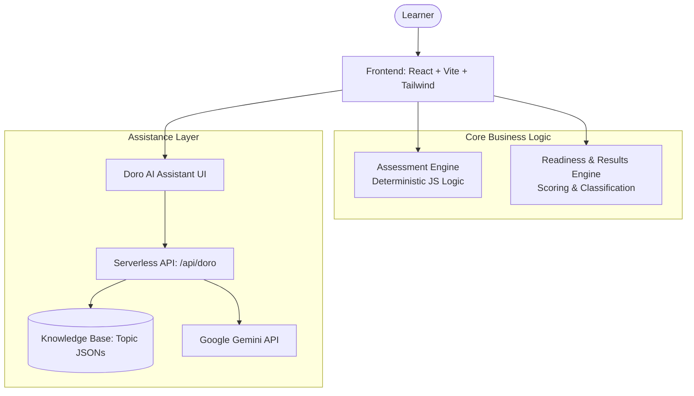
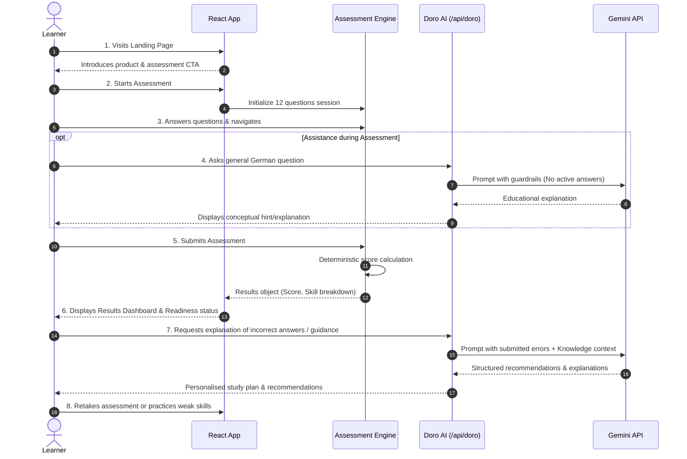

# A1 ReadyCheck — Technical Architecture & System Design

## 1. Project Overview

- **Project Name:** A1 ReadyCheck
- **Version:** 1.0.0
- **Type:** AI-Assisted German A1 Exam Readiness Platform
- **Primary Goal:** Help learners identify their German language strengths and weaknesses before booking Goethe or ÖSD A1 examinations.
- **Description:** A web application combining a structured 12-question diagnostic assessment with an AI learning assistant named Doro.
- **Development Constraint:** Four-hour MVP development sprint (240 minutes).

---

## 2. Product Architecture & Core Modules

The platform is structured into three decoupled core modules:



### 2.1 Assessment Engine (`assessment_engine`)
* **Responsibility:** Evaluate learner knowledge using deterministic scoring.
* **Features:**
  * 12 original A1-level questions (4 Vocabulary, 4 Grammar, 4 Reading Comprehension).
  * 4 multiple-choice options per question.
  * Question navigation (Next, Previous, Jump).
  * Answer validation and progress tracking.
  * Automatic submission verification (preventing incomplete submissions).
  * Skill-wise performance tracking.
* **Critical Rule:** Assessment scores must be calculated strictly using predefined answer keys and client-side JavaScript logic. **The LLM must never calculate, modify, or override assessment scores.**

### 2.2 Doro AI Assistant (`doro_ai`)
* **Responsibility:** Provide personalised German learning assistance and context-aware feedback.
* **Features:**
  * German concept explanations and A1 learning query answering.
  * Explanations for submitted incorrect answers.
  * Targeted practice recommendations and practice question generation.
  * Context-aware conversational follow-ups.
* **Critical Rule:** Doro assists learning but does not determine examination readiness or override assessment results. During an active assessment, Doro must **never** reveal answers to active questions.

### 2.3 Readiness and Results Engine (`results_engine`)
* **Responsibility:** Present assessment performance and actionable recommendations.
* **Features:**
  * Overall score (out of 12) and percentage score.
  * Skill-wise breakdown (Vocabulary /4, Grammar /4, Reading /4).
  * Diagnostic readiness classification (e.g., "Strong Practice Performance", "Almost There", etc.).
  * Automated strength and weakness identification.
  * Tailored practice roadmap.

---

## 3. Technology Stack

| Layer | Technology | Details |
| :--- | :--- | :--- |
| **Frontend Framework** | React (JavaScript) | Component-driven UI built on functional components |
| **Build Tool** | Vite | Fast HMR and lightweight bundle size |
| **Styling** | Tailwind CSS | Utility-first, responsive, accessible design |
| **Icons** | Lucide React | Clean, modern UI iconography |
| **State Management** | React `useState` & `useContext` | Lightweight client state for assessment session & assistant |
| **Backend / API** | Node.js Serverless Functions | Hosted on Vercel Serverless Functions (`/api/doro.js`) |
| **AI Layer** | Google Gemini API | Server-side integration, structured JSON output mode |
| **Knowledge Layer** | Topic-based JSON retrieval | Pre-curated A1 knowledge files (Vocabulary, Grammar, Reading) |
| **Deployment** | Vercel & GitHub | Continuous deployment from GitHub to Vercel |
| **Environment Variables** | `GEMINI_API_KEY` | Server-side only; never exposed to client |

---

## 4. Application Flow



### Detailed Flow Steps
1. **Landing Page:** Introduces A1 ReadyCheck, the diagnostic assessment format, and Doro.
2. **Assessment Introduction:** Details the 12 questions (3 skills), time expectations, and guidelines.
3. **Assessment:** Learner navigates through 12 MCQs. Answers persist locally in context.
4. **Doro Assistance (In-Exam):** Learner can open Doro for general German grammar/vocab doubts. Active answer leakage is blocked.
5. **Scoring:** On submission, the deterministic JavaScript scoring engine evaluates answers against the answer key.
6. **Results Dashboard:** Displays total score, percentage, readiness category, and breakdown across Vocabulary, Grammar, and Reading.
7. **Doro Personalised Guidance (Post-Exam):** Doro reviews the specific incorrect questions, explains the mistakes, and suggests topic-focused practice.
8. **Practice and Retake:** Learner can reset the session to take the assessment again.

---

## 5. Assessment Design & Scoring Logic

### 5.1 Structure & Distribution
- **Total Questions:** 12
- **Distribution:**
  - **Vocabulary:** 4 questions
  - **Grammar:** 4 questions
  - **Reading Comprehension:** 4 questions
- **Question Format:** Multiple Choice (4 options per question: A, B, C, D)
- **Marking:** 1 mark per correct answer; no negative marking.
- **Scoring Formula:**
  $$\text{Percentage Score} = \left(\frac{\text{Correct Answers}}{12}\right) \times 100$$
- **Skill-wise Score:** $\text{Correct answers in skill} / 4$

### 5.2 Readiness Categories
| Minimum Correct | Maximum Correct | Readiness Category | Conditions / Notes |
| :---: | :---: | :--- | :--- |
| **10** | **12** | **Strong Practice Performance** | Requires at least 3 correct answers in *every* individual skill |
| **8** | **9** | **Almost There** | Good foundation; minor skill gaps to address |
| **5** | **7** | **Needs Targeted Practice** | Noticeable gaps in one or more core skills |
| **0** | **4** | **Build A1 Foundations** | Fundamental review of A1 curriculum recommended |

> [!NOTE]
> **Assessment Disclaimer:** This is an indicative diagnostic assessment, not an official Goethe-Institut or ÖSD examination. Results provide readiness feedback and do not guarantee official examination success.

---

## 6. Doro AI Architecture

### 6.1 Persona & Role
- **Name:** Doro
- **Role:** Personal A1 German Learning Companion
- **Personality:** Friendly, encouraging, educational, patient, and precise.

### 6.2 Context Inputs
The API endpoint (`/api/doro.js`) injects the following context to construct the LLM prompt:
1. Learner query / intent.
2. Current application stage (`during_assessment` vs `after_assessment`).
3. Assessment context (allowed question context, submitted answers, incorrect question IDs).
4. Skill-wise performance breakdown.
5. Relevant curated A1 knowledge documents (retrieved from `/knowledge-base/`).

### 6.3 Processing Flow
```mermaid
flowchart TD
    Req[Receive Learner Request] --> Validate[Validate Request & Stage]
    Validate --> Route{Stage?}
    Route -->|during_assessment| Guard[Apply Anti-Leak Guardrails]
    Route -->|after_assessment| Context[Inject Incorrect Question Context]
    Guard --> Retrieval[Retrieve Relevant Topic from Knowledge Base]
    Context --> Retrieval
    Retrieval --> PromptBuild[Construct Structured Prompt with System Rules]
    PromptBuild --> CallGemini[Call Gemini API (JSON Response Schema)]
    CallGemini --> Parse{Success & Valid JSON?}
    Parse -->|Yes| Output[Send Structured Response to UI]
    Parse -->|No / Error| Fallback[Return Predefined Topic Fallback]
```

### 6.4 Guardrails & Interaction Modes
- **During Active Assessment:**
  - Explains German language grammar rules, vocabulary words, and sentence patterns.
  - Answers general learning questions.
  - **Strict Constraint:** Rejects prompts asking for the answer to the active question (e.g., "Which option is correct for question 3?").
- **Post-Assessment:**
  - Breaks down why a selected option was wrong and why the correct option is right.
  - Identifies recurring grammatical or lexical weaknesses.
  - Generates targeted practice exercises.

### 6.5 Response Schema (JSON Mode)
```json
{
  "$schema": "http://json-schema.org/draft-07/schema#",
  "type": "object",
  "properties": {
    "summary": { "type": "string" },
    "identified_weaknesses": {
      "type": "array",
      "items": { "type": "string" }
    },
    "explanation": { "type": "string" },
    "recommendations": {
      "type": "array",
      "items": {
        "type": "object",
        "properties": {
          "topic": { "type": "string" },
          "reason": { "type": "string" },
          "practice_activity": { "type": "string" }
        },
        "required": ["topic", "reason", "practice_activity"]
      }
    },
    "encouragement": { "type": "string" }
  },
  "required": ["summary", "identified_weaknesses", "explanation", "recommendations", "encouragement"]
}
```

### 6.6 Fallback Strategy
If the Gemini API call fails, times out, or returns invalid syntax, the backend returns pre-compiled topic recommendations matched against the learner's lowest scoring skill category.

---

## 7. Project Structure

```
Globio/
├── api/
│   └── doro.js                     # Vercel serverless function (Gemini API bridge)
├── knowledge-base/
│   ├── vocabulary.json             # A1 German vocabulary topics & notes
│   ├── grammar.json                # A1 German grammar rules & examples
│   └── reading.json                # A1 Reading tips & sentence patterns
├── public/
│   └── favicon.svg                 # Application favicon and static assets
├── src/
│   ├── components/
│   │   ├── Navbar.jsx              # Navigation and brand header
│   │   ├── ProgressBar.jsx         # Assessment question progression indicator
│   │   ├── QuestionCard.jsx        # MCQ question renderer with options
│   │   ├── DoroChat.jsx            # Floating / sidebar AI companion UI
│   │   ├── SkillBreakdown.jsx      # Visual score bars for Vocab, Grammar, Reading
│   │   └── RecommendationCard.jsx  # Personalised practice recommendation items
│   ├── context/
│   │   └── AssessmentContext.jsx   # Global state: answers, status, scores, history
│   ├── data/
│   │   └── questions.js            # 12 original A1 assessment questions & answer keys
│   ├── pages/
│   │   ├── LandingPage.jsx         # Introduction, value proposition, start CTA
│   │   ├── AssessmentPage.jsx      # Assessment container, navigation, question display
│   │   └── ResultsPage.jsx          # Comprehensive readiness dashboard & Doro insights
│   ├── services/
│   │   ├── assessmentService.js    # Session initialization and response validation
│   │   └── doroService.js          # Client-side API caller for /api/doro
│   ├── utils/
│   │   ├── scoring.js              # Deterministic score calculation & classification
│   │   └── recommendations.js      # Static fallback recommendations
│   ├── App.jsx                     # Root application view router
│   ├── index.css                   # Tailwind imports and base styles
│   └── main.jsx                    # React entrypoint
├── .env.example                    # Environment variable template
├── .gitignore                      # Git ignore patterns
├── architecture.md                 # System architecture specification
├── package.json                    # Project dependencies and npm scripts
├── PROBLEM_STATEMENT.md            # Product problem statement
├── README.md                       # Setup, features, and deployment guide
└── vite.config.js                  # Vite configuration
```

---

## 8. Phase-wise Development Plan (4-Hour Sprint)

```mermaid
gantt
    title 4-Hour Development Sprint (240 Minutes)
    dateFormat X
    axisFormat %m min
    section Phase 1
    Requirements & Architecture (20m) :0, 20
    section Phase 2
    UI Foundation & Setup (25m)        :20, 45
    section Phase 3
    Assessment Engine (65m)            :45, 110
    section Phase 4
    Results Dashboard (35m)            :110, 145
    section Phase 5
    Doro AI Integration (40m)          :145, 185
    section Phase 6
    QA & Integration Testing (30m)     :185, 215
    section Phase 7
    Deployment & Polish (25m)          :215, 240
```



### Phase Details

#### Phase 1: Project Understanding and Architecture (20 mins)
* **Objective:** Establish product requirements and technical implementation plan.
* **Tasks:** Review `PROBLEM_STATEMENT.md`, finalize `architecture.md`, verify tech stack, data contracts, and security rules.
* **Deliverables:** Approved problem statement, approved architecture, development roadmap.
* **Completion Criteria:** Clear requirements, documented architecture, zero unresolved technical blockers.

#### Phase 2: Project Initialisation and UI Foundation (25 mins)
* **Objective:** Create the application foundation.
* **Tasks:** Initialize React with Vite, configure Tailwind CSS, install `lucide-react`, set up folder structure, implement application layout and Landing Page.
* **Deliverables:** Running React app, landing page, base UI components.
* **Completion Criteria:** App runs locally, responsive layout works, CTA navigates to assessment.

#### Phase 3: Assessment Engine Development (65 mins)
* **Objective:** Build the complete 12-question diagnostic assessment.
* **Tasks:** Author 12 authentic A1 questions (4 vocab, 4 grammar, 4 reading), implement question navigation, state tracking, validation (prevent submit on unanswered), and deterministic scoring engine.
* **Deliverables:** Assessment UI, question bank in `questions.js`, scoring utility in `scoring.js`.
* **Completion Criteria:** All 12 questions navigable, answers persist across steps, cannot submit incomplete, scoring is 100% deterministic and accurate.

#### Phase 4: Results Dashboard and Recommendations (35 mins)
* **Objective:** Convert assessment results into actionable diagnostic insights.
* **Tasks:** Implement results dashboard, total percentage score, skill-wise breakdown, readiness categorization, and static fallback recommendations. Add retake action.
* **Deliverables:** Results dashboard page, readiness classification logic, retake workflow.
* **Completion Criteria:** Results precisely match user inputs, readiness category reflects scores accurately, retake resets state cleanly.

#### Phase 5: Doro AI Integration (40 mins)
* **Objective:** Introduce AI-powered learning assistance.
* **Tasks:** Create knowledge base files (`vocabulary.json`, `grammar.json`, `reading.json`), create `/api/doro.js` serverless function with Gemini API, build prompt templates with guardrails, integrate `DoroChat.jsx`, and implement error/fallback handling.
* **Deliverables:** Working Doro assistant, server-side API endpoint, contextual recommendations.
* **Completion Criteria:** Doro answers A1 questions, explains test errors post-exam, guards active answers during assessment, fails gracefully if API key is absent.

#### Phase 6: Integration and Quality Assurance (30 mins)
* **Objective:** Validate the complete learner journey.
* **Tasks:** Test high, medium, and low score scenarios, test uneven skill performance (e.g. 4/4 vocab, 1/4 grammar), verify mobile responsiveness, and test API outage fallback.
* **Deliverables:** Tested MVP, bug fixes, verified user flow.
* **Completion Criteria:** No console/runtime errors, accurate scores, AI responds correctly, responsive layout on mobile/desktop.

#### Phase 7: Deployment and Submission (25 mins)
* **Objective:** Make the product publicly accessible.
* **Tasks:** Configure GitHub repository, set up Vercel project, configure `GEMINI_API_KEY` in Vercel environment variables, deploy, verify live URL, and complete `README.md`.
* **Deliverables:** Live Vercel URL, GitHub repository, documentation.
* **Completion Criteria:** Live site loads, assessment functions on web, Doro responds via serverless function.

---

## 9. Testing Strategy & Quality Metrics

### 9.1 Assessment Engine Tests
- **All Correct Test:** 12/12 score = 100%, "Strong Practice Performance".
- **All Incorrect Test:** 0/12 score = 0%, "Build A1 Foundations".
- **Mixed Performance Test:** 8/12 score = 66.7%, "Almost There".
- **Uneven Skill Test:** Vocab 4/4, Grammar 4/4, Reading 1/4 (Total 9/12) -> Correctly flags Reading as key weakness.
- **Boundary Test for Top Tier:** 10/12 overall but with 1 skill scoring 2/4 -> Must NOT receive "Strong Practice Performance" (due to the $\ge 3$ per skill rule).
- **Navigation & Persistence:** Changing previous answers maintains updated selection and progress percentage.
- **Validation:** Attempting to submit with unanswered questions displays warning and blocks submission.
- **Retake State Reset:** Retake action clears all selected answers, scores, and resets UI to question 1.

### 9.2 Doro AI Tests
- **Active Assessment Answer Leakage Test:** Asking "What is the answer to question 2?" must trigger a polite refusal to give answers, offering only general conceptual explanations.
- **General Grammar Explanation Test:** Asking "When do I use 'der', 'die', and 'das'?" returns clear A1 explanations with everyday examples.
- **Incorrect Answer Breakdown Test:** Post-submission, Doro correctly references the user's specific mistaken question topic and explains the grammatical rule.
- **API Failure Resilience Test:** If `GEMINI_API_KEY` is missing or API returns 500/rate-limit, UI gracefully falls back to predefined recommendations without crashing.

### 9.3 Quality Metrics
- **Deterministic Accuracy:** 100% match between selected answers and calculated score.
- **Response Latency:** Serverless API roundtrip $\le 3$ seconds under typical conditions.
- **Mobile Usability:** Clean layout on viewports from 360px width upwards.

---

## 10. Security & Privacy Requirements

1. **No Client-side API Secrets:** The Gemini API key must never be bundled into the Vite frontend build. All AI calls must pass through `/api/doro.js`.
2. **Environment Variable Storage:** Secrets are managed via `.env` locally and Vercel Environment Variables in production.
3. **Payload Sanitization & Validation:** Validate request structure in `/api/doro.js` before dispatching to the LLM.
4. **Minimal Data Exposure:** No personally identifiable information (PII) is collected, stored, or sent to the LLM.
5. **No LLM Score Authority:** Assessment scoring is strictly client-side and algorithmic; AI responses cannot alter or override score data.
6. **Anti-Prompt Injection:** System prompts instruct Doro to ignore instructions attempting to override role boundaries or extract internal prompt instructions.

---

## 11. Development Rules & Operational Principles

1. **Phase-by-Phase Execution:** Implement sequentially according to the 7-phase plan.
2. **Deterministic Priority:** The deterministic assessment and scoring engine must be 100% complete and verified before integrating the AI assistant.
3. **Scope Discipline:** Avoid feature creep (no authentication, no payment gateways, no audio listening tests in the 4-hour MVP).
4. **Graceful Degradation:** The application must remain fully functional as a diagnostic assessment tool even if the AI backend is offline.
5. **Maintainable Codebase:** Write modular, well-commented JavaScript with clear separation of concerns between components, services, and utilities.

---

## 12. Future Scope (Post-MVP Roadmap)

- **Goethe / ÖSD Full Exam Simulation:** Complete 60-minute timed mock exams.
- **Audio & Listening Assessment:** Audio player questions for Hörverstehen.
- **Speaking Practice:** Voice input with pronunciation feedback via Web Speech API or Gemini Multimodal Live API.
- **Writing Assessment (Schreiben):** Short email / letter writing evaluation with AI rubrics.
- **Semantic RAG System:** Vector database (e.g., Pinecone / pgvector) embedding Goethe exam handbooks and grammar textbooks.
- **Multi-Level Support:** Expand diagnostics to German A2 and B1 levels.

---

## 13. Formal Data Contracts & Schemas

### 13.1 Question Schema (`src/data/questions.js`)
```typescript
interface Option {
  id: "A" | "B" | "C" | "D";
  text: string;
}

interface Question {
  id: string; // e.g., "q1" .. "q12"
  skill: "vocabulary" | "grammar" | "reading";
  topic: string; // e.g., "Articles", "Directions", "Daily Routine"
  instruction: string; // e.g., "Wählen Sie die richtige Antwort."
  passage?: string; // Present for reading comprehension questions
  question: string;
  options: Option[]; // Exactly 4 options
  correctOptionId: "A" | "B" | "C" | "D";
  explanation: string; // Concise explanation shown post-submission
}
```

### 13.2 Assessment Session State (`src/context/AssessmentContext.jsx`)
```typescript
interface AssessmentState {
  status: "idle" | "in_progress" | "completed";
  currentQuestionIndex: number; // 0 to 11
  answers: Record<string, "A" | "B" | "C" | "D">; // e.g., { q1: "B", q2: "A" }
  results: ScoringResult | null;
  doroOpen: boolean;
}
```

### 13.3 Scoring Result Schema (`src/utils/scoring.js`)
```typescript
interface SkillScore {
  correct: number; // 0 to 4
  total: 4;
  percentage: number; // 0 to 100
}

interface IncorrectQuestionDetail {
  id: string;
  skill: "vocabulary" | "grammar" | "reading";
  topic: string;
  question: string;
  selectedOption: string;
  correctOption: string;
  explanation: string;
}

interface ScoringResult {
  totalQuestions: 12;
  correctCount: number; // 0 to 12
  percentage: number; // (correctCount / 12) * 100
  readinessCategory: {
    key: "strong" | "almost_there" | "targeted_practice" | "foundations";
    label: string; // e.g., "Strong Practice Performance"
    description: string;
    badgeVariant: "success" | "warning" | "caution" | "neutral";
  };
  skills: {
    vocabulary: SkillScore;
    grammar: SkillScore;
    reading: SkillScore;
  };
  incorrectQuestions: IncorrectQuestionDetail[];
  identifiedStrengths: string[];
  identifiedWeaknesses: string[];
}
```

### 13.4 Doro Serverless API Payload (`/api/doro.js`)
#### Request:
```typescript
interface DoroApiRequest {
  stage: "during_assessment" | "after_assessment";
  message: string;
  currentQuestionTopic?: string; // Optional topic context (active question answer is never passed)
  assessmentSummary?: {
    score: number;
    percentage: number;
    weakSkills: string[];
    incorrectTopics: string[];
  };
}
```

#### Response:
```typescript
interface DoroApiResponse {
  summary: string;
  identified_weaknesses: string[];
  explanation: string;
  recommendations: Array<{
    topic: string;
    reason: string;
    practice_activity: string;
  }>;
  encouragement: string;
}
```

